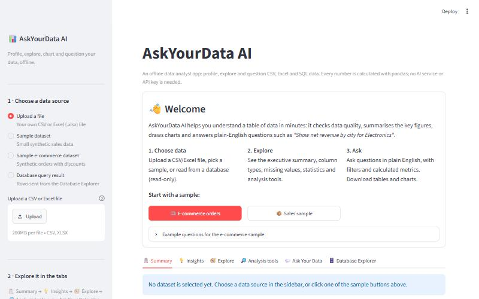
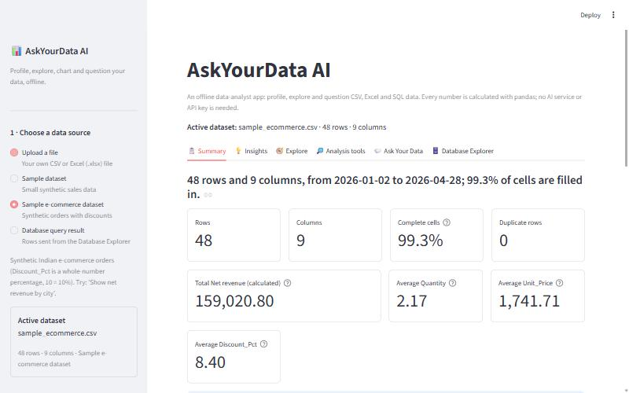
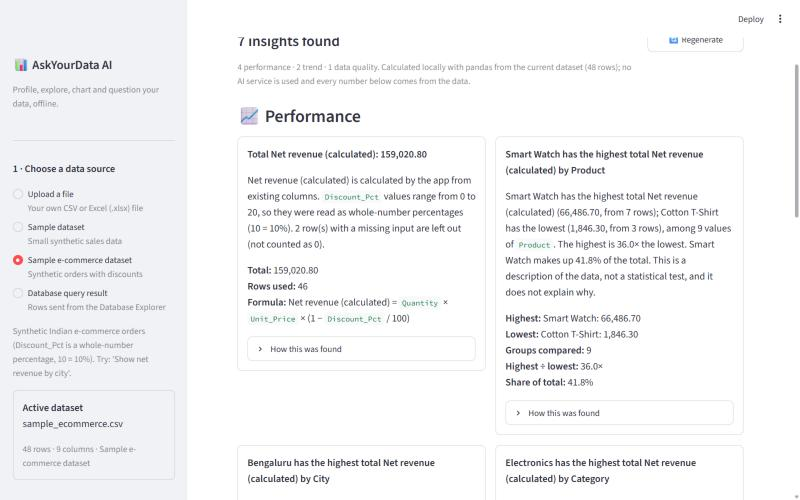
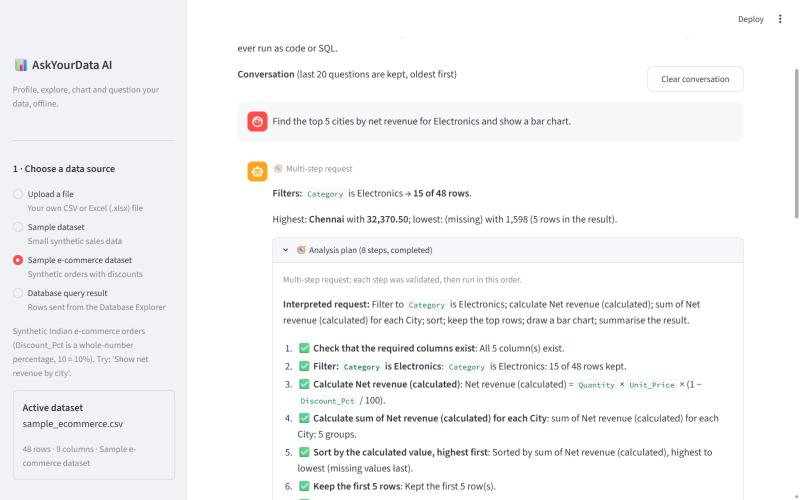
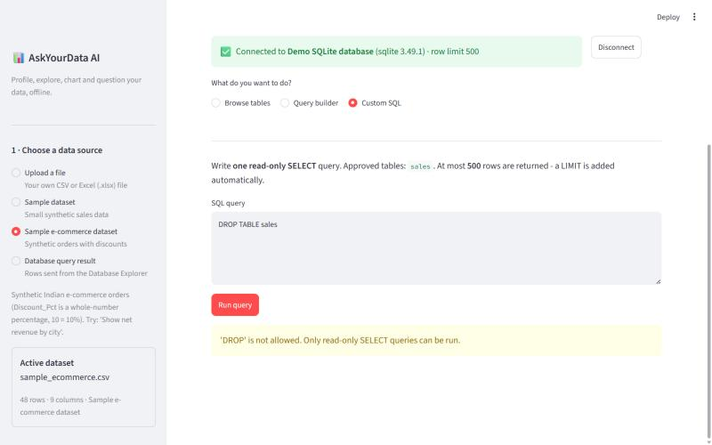
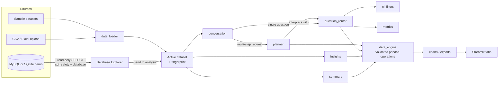

# AskYourData AI

**A local data-analyst web app built with Python and Streamlit.** Load a CSV or
Excel file, or read from a SQL database in read-only mode. The app then
profiles the data, summarises it, finds patterns, draws charts and answers
plain-English questions, including follow-ups and multi-step requests.

> **How the "AI" works:** the question answering, follow-ups, planning and
> insights are **deterministic, rule-based Python**. Fixed patterns pick one of a
> set of approved, validated analysis functions, and every number is calculated
> with pandas. **No LLM, AI service, API key or internet connection is used.**
> The same question on the same data always gives the same answer. The app can't
> invent numbers, but it only understands the kinds of requests it was built for.

It runs locally on your computer and is not deployed publicly
(see [docs/DEPLOYMENT.md](docs/DEPLOYMENT.md) for a deployment assessment).

## Screenshots

Captured from the running app with the bundled **synthetic** e-commerce sample:

| | |
|---|---|
| **Welcome screen**<br> | **Executive summary**<br> |
| **Automatic insights**<br> | **Multi-step request with its analysis plan**<br> |
| **Database Explorer refusing `DROP TABLE`**<br> | |

## Key features

- **Data sources:**
  - CSV and Excel (`.xlsx`) upload, with clear errors for empty or corrupt files;
  - two synthetic sample datasets;
  - results sent from the Database Explorer.
- **📋 Executive summary:**
  - KPIs (ID columns are never averaged) and a calculated metric with its formula;
  - a date trend and a category comparison, each shown only when the data supports it;
  - data-quality notes.
- **💡 Automatic insights:** highest/lowest groups, top items, period-to-period
  changes and data-quality issues. Each one shows its supporting values and how it
  was calculated, and makes no causal or statistical-significance claims.
- **🧭 Explore / 🔎 Analysis tools:**
  - preview, column types, missing values, duplicates, statistics;
  - filter & sort, group & summarise, top N, trends, correlations, distributions.
- **💬 Ask Your Data:**
  - plain-English questions with filters (text, numbers, dates);
  - calculated metrics (gross amount, net revenue);
  - **conversational follow-ups** ("that city", "sort it", "plot it as a pie chart");
  - a **multi-step planner** that shows every validated step;
  - clarifying questions instead of guesses;
  - CSV / PNG / HTML exports.
- **🗄️ Database Explorer:**
  - read-only access to MySQL (or a built-in SQLite demo);
  - a table allowlist, SQL parsing, row limits, timeouts and bound parameters;
  - query results can be sent to every other tab.
- **Correct state:** all dataset-specific settings, answers and insights are reset
  when the data changes (dataset fingerprint), so nothing stale is shown.
- **749 automated tests**, including end-to-end runs of the Streamlit app.

## Technology stack

| Area | Tools |
|---|---|
| Language | Python 3.12 (3.10+ supported) |
| Web UI | Streamlit |
| Data | pandas, openpyxl (Excel) |
| Charts | Plotly |
| Database | SQLAlchemy, PyMySQL (MySQL), SQLite (demo and tests), sqlglot (SQL parsing), python-dotenv |
| Tests | pytest, Streamlit's `AppTest` |

## Architecture and data flow



- **Core logic** lives in [`askyourdata/`](askyourdata/) and contains no Streamlit
  code, so it is unit-tested directly. The UI files (`app.py`, `summary_view.py`,
  `insights_view.py`, `ask_your_data.py`, `database_explorer.py`) only draw controls
  and results.
- **One engine:** the analysis tools, summary, insights, router and planner all use
  the same validated functions in [`data_engine.py`](askyourdata/data_engine.py).
  Invalid requests raise `AnalysisError` with a readable message.
- **Question pipeline:**
  1. Safety screen (code, SQL and data-changing requests are refused).
  2. Dates are read.
  3. Filters are extracted ([`nl_filters.py`](askyourdata/nl_filters.py)).
  4. The intent is detected with fixed patterns.
  5. Phrases are matched to real columns, with synonyms ([`text_matching.py`](askyourdata/text_matching.py)).
  6. ONE engine function runs.
  7. The answer is built only from the returned numbers.
- **Follow-ups** ([`conversation.py`](askyourdata/conversation.py)) reuse the previous
  answer's structured context: validated columns, filters and the shown table.
  They never re-read answer text.
- **Multi-step plans** ([`planner.py`](askyourdata/planner.py)) are plain data:
  - a tuple of steps with one of eight allowlisted operations
    (`validate_columns → filter → metric → aggregate → sort → limit → chart → summarize`);
  - validated before and during execution;
  - execution stops at the first failed step and shows no result for a failed plan.

| Module | Purpose |
|---|---|
| `data_loader.py`, `profiling.py` | file loading and validation, profiling |
| `data_engine.py`, `charts.py`, `exports.py` | analysis functions, Plotly figures, downloads |
| `text_matching.py`, `nl_filters.py`, `metrics.py` | column matching, filters in questions, calculated metrics |
| `question_router.py`, `conversation.py`, `planner.py` | questions, follow-ups, multi-step plans |
| `summary.py`, `insights.py` | executive summary, automatic insights |
| `sql_safety.py`, `db_config.py`, `database.py` | read-only database access |
| `ui_state.py` | dataset fingerprint and stale-state reset |

## Getting started (Windows PowerShell)

Requires **Python 3.10 or newer**. Run these from the project folder.

```powershell
python -m venv .venv
.\.venv\Scripts\python.exe -m pip install --upgrade pip
.\.venv\Scripts\python.exe -m pip install -r requirements.txt
.\.venv\Scripts\python.exe -m streamlit run app.py
```

The app opens at http://localhost:8501; stop it with `Ctrl + C`.

- **Exact versions:** to install the package versions the test suite was last run
  with, use `requirements-lock.txt` instead of `requirements.txt`.
- **Port already in use:** if 8501 is busy (for example, the app is already running
  in another window), add `--server.port 8502`.
- **Activation blocked:** if `.\.venv\Scripts\Activate.ps1` is blocked by
  PowerShell's script policy, keep using the full `.\.venv\Scripts\python.exe`
  path as above. It works without changing any security settings.

## Using the sample datasets

On the welcome screen, click **🛒 E-commerce orders** or **📦 Sales sample**, or
choose them under **1 · Choose a data source** in the sidebar.

| File | Contents |
|---|---|
| [`data/sample_ecommerce.csv`](data/sample_ecommerce.csv) | 48 synthetic orders: Order_Date, City, Product, Category, Quantity, Unit_Price, **Discount_Pct (whole-number percentages, 10 = 10%)**, Payment_Method. A few gaps are included on purpose. |
| [`data/sample_sales.csv`](data/sample_sales.csv) | 30 synthetic sales rows with some missing values and 2 duplicate rows |

Both are synthetic; no real customer data is included.

## Example questions

Open **💬 Ask Your Data** with the e-commerce sample. The example buttons are
generated from the current dataset's real columns.

**Single questions** (each one is checked by `tests/test_readme_examples.py`):

```text
Show net revenue by city.
Which product has the highest net revenue?
Show total quantity for Electronics products.
Find the top 5 products in Pune.
Compare payment methods for orders above quantity 2.
Show orders between 2026-02-01 and 2026-02-28.
What is the order trend by month?
Are there any missing values?
```

**Clarifying questions instead of guesses:**

```text
Compare revenue across categories.     -> net revenue or gross amount?
Show orders from Pnue                  -> Did you mean Pune?
orders on 03/04/2026                   -> 3 April or March 4?
orders above 2                         -> which column should be above 2?
```

**A conversation** (each line follows up on the previous answer):

```text
Which city has the most orders?           -> Bengaluru has the most rows: 15
Show the top 5 products in that city.     -> filtered to City = Bengaluru
Sort it from lowest to highest.           -> the same table, re-sorted
Plot it as a pie chart.                   -> the same result as a pie chart
Now group them by category.               -> City = Bengaluru kept, grouped by Category
What about Pune?                          -> the same question for City = Pune
```

**Multi-step requests** (each shows a numbered 🧭 Analysis plan):

```text
Find the top 5 cities by net revenue for Electronics and show a bar chart.
Filter to Pune, group quantity by category, and sort descending.
Show the top 3 products by quantity and display a chart.
Calculate total quantity by category and explain the result.
```

**Requests that are refused safely**, with an explanation:
- "Show total quantity by category" followed by "plot it as a line chart"
  (a line chart needs dates);
- "Average unit price by category and show a pie chart" (a pie chart needs totals);
- "orders from Pune; DROP TABLE sales" (refused as SQL);
- "predict next month's revenue" (no forecasting).

## How the main features calculate

- **Calculated metrics:** gross amount = quantity × unit price; net revenue =
  quantity × unit price × (1 − discount).
  - How discounts are stored is decided **from the values**:
    - written with "%" or any value above 1 → percentages;
    - all between 0 and 1 → the app asks;
    - negative or above 100 → refused.
  - Missing inputs make the row's metric unknown (never 0).
  - An existing revenue column is used as is, never overwritten.
  - A price input must be named like a price.
- **Filters** match only values that really exist in the data. Unclear values,
  dates or columns get a clarifying question.
- **Automatic insights:**
  - Amount-like columns (quantity, units, revenue, sales, amount…) are **summed**;
    prices, rates, scores and percentages are **averaged**.
  - ID-like columns and unique-per-row text are excluded.
  - Trends compare the first and last *fully covered* periods.
  - Outliers (3 × IQR rule) and unusual negatives are labelled **potential** issues.
  - At most 6 performance, 2 trend and 8 data-quality insights are shown, in a fixed order.
- **Exports:** a CSV of exactly the table shown; the chart as PNG through the 📷
  icon in the chart toolbar, or as interactive HTML.

## Database Explorer and SQL safety

Use **Demo database (no setup needed)**, a temporary SQLite copy of the sales
sample, to try it without a database server. To connect to MySQL:

1. Create a **dedicated MySQL account with only `SELECT` permission** on the tables
   to explore. This is the most important protection: the app's own checks are an
   extra layer, **not a substitute for database permissions**.

   ```sql
   CREATE USER 'askyourdata_reader'@'localhost' IDENTIFIED BY 'choose-a-strong-password';
   GRANT SELECT ON askyourdata_demo.sales TO 'askyourdata_reader'@'localhost';
   ```

2. Copy the settings template and fill it in (the `.env` file is git-ignored):

   ```powershell
   Copy-Item .env.example .env
   notepad .env
   ```

   | Variable | Meaning | Default |
   |---|---|---|
   | `DB_HOST`, `DB_PORT` | MySQL server | `localhost`, `3306` |
   | `DB_NAME`, `DB_USER`, `DB_PASSWORD` | database and read-only account (the password may also be typed in the app) | required |
   | `DB_ALLOWED_TABLES` | comma-separated tables the app may read (`*` = all, not recommended) | none |
   | `DB_MAX_ROWS` | maximum rows per query (1–10,000) | `500` |
   | `DB_QUERY_TIMEOUT_SECONDS` | stop slow queries | `15` |
   | `DB_ALLOW_CUSTOM_SQL` | allow typed SELECT queries | `true` |
   | `DB_SSL_CA` | CA certificate for encrypted connections | empty |

3. Restart the app, open **🗄️ Database Explorer**, choose **MySQL server**, and click **Connect**.

**App-side protections:**
- **Statements:**
  - only single `SELECT` statements, checked by parsing the SQL with sqlglot;
  - `INSERT`/`UPDATE`/`DELETE`/`DROP`/`ALTER`/`CREATE`/`TRUNCATE`/`GRANT`/`CALL`/`SET`,
    `INTO OUTFILE`, `FOR UPDATE`, `LOCK`, multiple statements and dangerous
    functions such as `SLEEP` are rejected;
  - the executed SQL is re-generated without comments.
- **Tables:** only allowlisted tables may be read; `other_db.table` and invalid
  identifiers are refused.
- **Values:** the query builder sends values as bound parameters.
- **Limits:** a row limit (default 500) and a query timeout; MySQL sessions are set to read-only.
- **Secrets:** the password never appears in errors, logs or `repr()`.
- **Errors:** connection failures are explained, e.g. "Could not reach the MySQL
  server. Is it running, and are the host and port right?".

**Limitations:**
- The MySQL path has been tested against error cases (no server running) and
  through SQLite-based tests, **not against a live MySQL server**.
- Database results are capped at the row limit, so analyses of a database
  result only cover the rows that were fetched.

## Running the tests

```powershell
.\.venv\Scripts\python.exe -m pytest -v
```

**749 tests** passed in the last run. They need no MySQL server, API key or
internet: database tests use in-memory SQLite, and `tests/test_app.py` runs the
real Streamlit app headlessly (about 20 seconds). Run one file with e.g.
`.\.venv\Scripts\python.exe -m pytest tests\test_planner.py`.

| Test file | Tests | Covers |
|---|---:|---|
| `test_question_router.py` | 124 | intents, column matching, ambiguity, unsafe input |
| `test_sql_safety.py` | 85 | SELECT validation, allowlist, row limits |
| `test_planner.py` | 82 | plan construction, allowed/disallowed operations, execution, stopping on failure |
| `test_data_engine.py` | 79 | filtering, grouping, top N, trends, correlations |
| `test_conversation.py` | 77 | follow-ups, references, clarifications, bounded history, safety |
| `test_filters.py` | 66 | text / number / date filters |
| `test_database.py` | 41 | read-only database access (SQLite) |
| `test_metrics.py` | 38 | gross amount / net revenue, discount handling |
| `test_insights.py` | 35 | insight rules checked by hand, edge cases, reproducibility |
| `test_summary.py` | 30 | executive summary, fingerprints, stale-state reset, KPI layout |
| `test_app.py` | 25 | end-to-end Streamlit runs: tabs, dataset switching, insights, conversation, plans, SQL refusal |
| `test_exports.py` | 21 | CSV exports match the displayed tables |
| `test_readme_examples.py` | 17 | every example in this README behaves as described |
| `test_db_config.py` | 16 | `.env` settings, password never printed |
| `test_data_loader.py`, `test_profiling.py` | 13 | CSV/Excel loading (incl. Excel = CSV results), profiling |

## Limitations

- **Rule-based language understanding:** English only, fixed patterns and a fixed
  synonym list. Unusual wording gets "I'm not sure how to answer that" plus examples
  that work. One calculation per request.
- **Filters:**
  - exact text values only ("Pun" won't match "Pune");
  - no relative dates ("last month");
  - no filters on calculated metrics.
- **Metrics:** only gross amount and net revenue. Discounts must be per-row
  percentages or fractions.
- **Insights and summary:**
  - only the listed patterns are checked;
  - summing vs averaging is chosen from column names;
  - trends need exactly one date column;
  - no significance tests, forecasts or causes.
- **Follow-ups:**
  - build only on the latest successful answer;
  - "it"/"there" alone are not resolved;
  - references can't be combined with other steps in one request.
- **Files:** Excel reads the first sheet only. Streamlit's default upload limit is
  200 MB, and all data is held in memory.
- **Single user, local:** no login, and it is not deployed. PNG export uses the
  browser's chart toolbar.

## Future improvements

- Optional LLM assistance to rephrase unsupported questions into supported ones,
  still answered by the same validated engine.
- More metrics (profit, margin), relative date filters, multi-sheet Excel.
- Authentication and a hosted deployment (see [docs/DEPLOYMENT.md](docs/DEPLOYMENT.md)).
- Tests against a live MySQL server in a disposable container.

## Project history

Built in milestones:
1. upload and profiling;
2. analysis engine and charts;
3. read-only Database Explorer;
4. plain-English questions;
5. metrics, filters and exports;
6. executive summary and UI polish;
7. A: conversational follow-ups; B: multi-step planner; C: automatic insights;
8. audit and portfolio preparation.

Portfolio texts (a resume entry and short description) are in
[docs/PORTFOLIO.md](docs/PORTFOLIO.md).
